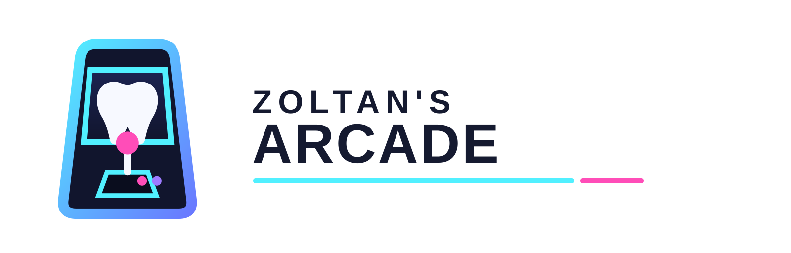

<p align="center">
  <picture>
    <source media="(prefers-color-scheme: dark)" srcset="docs/arcade-logo/arcade-wordmark-light.svg">
    
  </picture>
</p>

# 🕹️ Zoltan's Arcade — Arcade-Game-Center

[English](README.md) · [Deutsch](README.de.md) · **Magyar**

Egy portál tizenöt böngészős játékhoz — **Tetris, Snake, 2048, Pac-Man, Amőba (Gomoku), Tic-Tac-Toe, Breakout, Space
Invaders, Négy a sorban (Connect Four), Nut Sort, Texas Hold'em, Aknakereső (Minesweeper), Pasziánsz (Solitaire), Ulti és
Snapszer** — egy dizájnrendszerrel, egy pontozási modellel, automatikus mentéssel és folytatással, a kezdőlapon élő
bemutató demókkal és globális ranglistával. Minden játékban egy koppintásra ott a szabály, bármelyik menetet befejezheted
idő előtt úgy, hogy a pontod felkerüljön a ranglistára, telefonon pedig minden érintéssel és teljes képernyőn játszható.
Minden játék a **saját repójában** is megvan, és önállóan is buildelhető és futtatható.

[](https://github.com/ZoliQua/Arcade-Game-Center/actions/workflows/ci.yml)


Élőben: **https://dulzoltan.hu/arcade/**

---

## 📑 Tartalom

- [A játékok](#-a-játékok)
- [Funkciók](#-funkciók)
- [Gyors kezdés](#-gyors-kezdés)
- [A repó felépítése](#%EF%B8%8F-a-repó-felépítése)
- [A közös kit](#-a-közös-kit-arcadekit)
- [Pontozás, statisztika és mentések](#-pontozás-statisztika-és-mentések)
- [Az önálló repók szinkronban tartása](#-az-önálló-repók-szinkronban-tartása)
- [Ranglista API](#-ranglista-api)
- [Szkriptek](#-szkriptek)
- [Telepítés](#-telepítés)
- [Közreműködés](#-közreműködés)
- [Licenc](#%EF%B8%8F-licenc)

## 🎮 A játékok

| Játék | Önálló repó | Műfaj | A portálban |
| --- | --- | --- | --- |
| 🧱 Tetris | [Tetris-Game](https://github.com/ZoliQua/Tetris-Game) | Arcade — SRS forgatás, 7-es zsák, tartalék, szellemidom, lerakási késleltetés | `apps/tetris` |
| 🐍 Snake | [Snake-Game](https://github.com/ZoliQua/Snake-Game) | Reflex — 1–10-es sebesség, átjárás a falon | `apps/snake` |
| 🔢 2048 | [2048-Game](https://github.com/ZoliQua/2048-Game) | Fejtörő — húzás, visszavonás, animációk | `apps/2048` |
| 🟡 Pac-Man | [Pac-Man-Game](https://github.com/ZoliQua/Pac-Man-Game) | Labirintus — négy szellem-MI, erőpirulák, szintek | `apps/pacman` |
| ⚫ Amőba | [Gomoku-Game](https://github.com/ZoliQua/Gomoku-Game) | Stratégia — 15×15, α-β minimax MI | `apps/gomoku` |
| 🦷 Tic-Tac-Toe | [Tic-Tac-Toe-Game](https://github.com/ZoliQua/Tic-Tac-Toe-Game) | Párbaj — fog vagy X/O jelek, legyőzhetetlen MI | `apps/tictactoe` |
| 🏓 Breakout | [Breakout-Game](https://github.com/ZoliQua/Breakout-Game) | Ütős — söprő ütközésvizsgálatú labda, bónuszok, több labda, körbeérő szintek | `apps/breakout` |
| 👾 Space Invaders | [Space-Invaders-Game](https://github.com/ZoliQua/Space-Invaders-Game) | Lövöldözős — menetelő hullámok, morzsolódó bunkerek, rejtélyes UFO | `apps/invaders` |
| 🔴 Négy a sorban | [Connect-Four-Game](https://github.com/ZoliQua/Connect-Four-Game) | Párbaj — 7×6, bitboard negamax MI | `apps/connect4` |
| 🔩 Nut Sort | [Nut-Sort-Game](https://github.com/ZoliQua/Nut-Sort-Game) | Rendezős — 20 rögzített szint bizonyított parral, színtévesztőknek alakkódolás | `apps/nutsort` |
| 🃏 Texas Hold'em | [Texas-Holdem-Game](https://github.com/ZoliQua/Texas-Holdem-Game) | Kártya — no-limit sit & go 15 karakter ellen, saját stílussal és árulkodó jelekkel | `apps/holdem` |
| 💣 Aknakereső | [Minesweeper-Game](https://github.com/ZoliQua/Minesweeper-Game) | Logika — klasszikus, hatszögletű és időre menő tábla, biztonságos első kattintás | `apps/minesweeper` |
| ♠️ Pasziánsz | [Solitaire-Game](https://github.com/ZoliQua/Solitaire-Game) | Kártya — Klondike, Pók és FreeCell tippekkel, visszavonással és automatikus befejezéssel | `apps/solitaire` |
| 🎴 Ulti | [Ulti-Game](https://github.com/ZoliQua/Ulti-Game) | Kártya — a háromszemélyes magyar klasszikus két gép ellen, 1835-ös Tell-kártya újrarajzolva | `apps/ulti` |
| 🂡 Snapszer | [Snapszer-Game](https://github.com/ZoliQua/Snapszer-Game) | Kártya — a magyar verseny a 66 pontért ketten vagy hárman, bemondások, betakarás, kontra | `apps/snapszer` |

## ✨ Funkciók

- 🏠 **Kezdőlap működő miniatűrökkel** — minden kártyán a valódi játékmotor fut robotpilótával / MI-vel (bemutató mód); a demók a képernyőn kívül megállnak, és figyelembe veszik a *csökkentett mozgás* beállítást
- 📖 **Szabályok minden játékban** — a „Szabályok” / "Rules" / „Regeln” gomb megmutatja a célt, a játékmenetet, a szabályokat, a pontozást (a számokat a játék saját konstansaiból számolja), a fogas módot, érintőképernyőn pedig a „Mobilon” részt is
- 🏁 **Befejezés idő előtt** — a „Befejezés” / "Finish" / „Beenden” gomb egy oldalon belüli megerősítés után lezárja a menetet, és az addig elért pontot rangsorolja (az Ultiban és a Snapszerben két osztás között)
- 📱 **Érintés és teljes képernyő** — húzás, koppintás, hosszú nyomás és képernyős gombok minden játékban, hüvelykujjnyi célpontok, és amíg az ujjad a táblán van, nem görgetsz el az oldallal; a teljes képernyő gomb ott, ahol van, a valódi Fullscreen API-t használja, iPhone-on pedig a biztonsági sávokat (safe area) is figyelő magával ragadó módot
- 💾 **Automatikus mentés és folytatás** — menet közben otthagyhatod a játékot, újratöltheted az oldalt, válthatsz másikra: a menet szüneteltetve tér vissza (*Üdv újra*); a *Folytasd, ahol abbahagytad* sáv felsorolja a mentett meneteket
- 🏆 **Egy pontozási modell** — minden befejezett menetet pontosan egyszer, ugyanazokkal a szabályokkal rögzít (rekord, játszmák, győzelmek, összpontszám, játékidő); a párbajjátékok egy közös körpont-képletet használnak
- 🧭 **Hash alapú útvonalak** — `#/play/snake`, `#/leaderboard`, `#/settings`: az újratöltés, a könyvjelzők és a vissza gomb egyszerűen működnek
- 🌍 **Három nyelv** — angol, magyar és német minden játékban és a portálban, a felső sávból vagy a beállításokból; a `?lang=en|hu|de` linkből is átadja a nyelvet, a számok pedig a nyelv szerinti tagolást követik
- 🦷 **Fogas mód** — egy „Fogas mód” / "Dental mode" / „Zahnmodus” kapcsoló, alapból kikapcsolva (vagy `?dental=1`), közös a portálban és mind a tizenöt játékban; mindegyik fogakat, fogkeféket és fogkrémet kap; csak a megjelenés változik
- 🌗 **Egy dizájnrendszer** — tokenek és `arc-*` komponensek közösen a portálban és minden játékban, sötét és világos téma (**T**), a lapok között szinkronban
- 📊 **Élő fejléc** — az állapot, a pontszám és a menetidő egyenesen a futó játékból jön
- 🌍 **Globális ranglista** — kis PHP + MySQL API kéréskorláttal és ésszerűségi plafonokkal
- ⌨️ **Billentyűzet először, mindenhol ugyanazok a gombok** — **P/Esc** szünet, **R** újrakezdés, **T** téma, **?** súgó
- 🧪 **Tesztelve** — a kit, a játékok és a portál egyetlen Vitest-futásban; CI Node 20-on és 22-n

## 🚀 Gyors kezdés

```bash
git clone https://github.com/ZoliQua/Arcade-Game-Center.git
cd Arcade-Game-Center
npm install
npm run dev                       # a portál: http://localhost:5173
npm run dev:game @arcade/gomoku   # bármelyik játék önmagában, egyenesen az apps/ mappából
```

## 🗂️ A repó felépítése

```
apps/
  portal/        @arcade/portal    a játékosoknak szóló Vite-alkalmazás (kezdőlap, játék, ranglista, beállítások)
  tetris/ snake/ 2048/ pacman/ gomoku/ tictactoe/ breakout/ invaders/ connect4/ nutsort/ holdem/
  minesweeper/ solitaire/ ulti/ snapszer/
                 @arcade/<id>      minden önálló repó tükre: src/, index.html, public/, vite.config.ts
packages/
  kit/           @arcade/kit       közös futtatókörnyezet: statisztika, mentések, téma, hookok, érintés, teljes képernyő, szabályok, befejezés, magyar kártya, arcade.css
  ui/            @arcade/ui        csak a portálé: oldalsáv, fejléc, ikonok, portál- és kezdőlap-CSS
arcade-api/                        PHP ranglista API (score.php, leaderboard.php)
scripts/
  sync-games.mjs                   kit → játékok, játékrepó ⇄ apps/<id>, eltérésellenőrzés
  write-app-manifests.mjs          legenerálja az apps/<id>/package.json + tsconfig.json fájlokat
  repo-docs.mjs                    beírja a közös közösségi fájlokat minden repóba
  mobile-smoke.mjs                 fej nélküli iPhone füstteszt minden játékra a buildelt portálban (CI-n kívül)
docs/                              DEPLOY.md, ADDING-A-GAME.md, history/
```

Minden játék ugyanazt a szerződést exportálja: `<XxxGame embedded onGameOver onRunEnd onStatusChange />` és `<XxxDemo active />`
(`ArcadeGameProps` / `ArcadeDemoProps` a [`packages/kit/src/types.ts`](./packages/kit/src/types.ts) fájlban).

## 🧰 A közös kit (`@arcade/kit`)

A [`packages/kit/src`](./packages/kit/src) az egyetlen forrása mindannak, ami a játékokban közös. Mivel minden játéknak
önállóan is buildelhetőnek kell lennie, a kit minden játékba **bemásolva** kerül `src/arcade/` néven — bájtra pontosan,
ott soha nem szerkesztjük. A portálban egy kis Vite-bővítmény minden másolatot visszairányít a `packages/kit`-re, így a
csomagban csak egyszer szerepel.

| Modul | Mit csinál |
| --- | --- |
| `stats.ts` | `recordRun`, `readStats`, `summarize`, `resetStats` — az egyetlen pontozási modell, átköltözteti a régi `<id>.highScore` kulcsokat |
| `session.ts` | `saveSession`, `loadSession` (sémaverziós, ellenőrzött, 30 napig érvényes), `peekSession`, `clearSession` |
| `hooks.ts` | `useArcadeRun`, `useSessionAutosave`, `useRestoredSession`, `useRunTimer`, `useGameStats`, `useArcadeTheme`, `useInView` |
| `scoring.ts` | `duelRoundScore` az Amőbához, a Tic-Tac-Toe-hoz és a Négy a sorbanhoz |
| `touch.ts` | `useIsTouch`, `useSwipe`, `useLongPress` — gesztusok a `.arc-board-touch` / `.arc-board-tap` jelölésű táblákhoz |
| `immersive.ts` | `useImmersive` — natív teljes képernyő, iPhone-on pedig a CSS-es magával ragadó mód (`html[data-arcade-immersive]`) |
| `components/` | `StatPanel`, `GameOverlay`, `SaveBadge`, `KeyHelp`, `StatusPill`, `ArcadeShell` (önálló oldalkeret), `RulesButton`, `FinishButton`, `FullscreenButton`, `TouchPad`, `TouchHelp`, `PlayingCard` |
| `hungarian/` | a magyar (Tell-) kártya, közös az Ultiban és a Snapszerben |
| `arcade.css` | dizájntokenek (sötét/világos), `arc-*` komponensek, önálló oldalelrendezés |
| `registry.ts` | az összes játék neve, repója, címkéi és kiemelőszíne |

## 📊 Pontozás, statisztika és mentések

- Egy menet akkor ér véget, amikor a játék eléri a `gameOver` állapotot (párbajjátékokban egy kör végén). A `useArcadeRun` menetenként **pontosan egyszer** rögzíti.
- `localStorage` kulcsok: `arcade.stats.<id>` (statisztika), `arcade.session.<id>` (automatikus mentés), `arcade.theme`, `arcade.nickname`,
  `arcade.sidebarCollapsed`. Az önálló játékok és a portál ugyanazokat a kulcsokat használják, így azonos originen közösek az adatok.
- A rangsorolt menetek frissítik a **Rekordot** és az **Összpontszámot**, és ha van beceneved, felkerülnek a ranglistára.
  A helyi kétszemélyes körök nem rangsoroltak (csak a játszmákat és az időt számolják).
- **Párbaj körpont** = `alap × (1 + az üres mezők aránya)` győzelemnél, `alap / 4` döntetlennél, 0 vereségnél;
  alap = 100 / 250 / 500 könnyű / közepes / nehéz szinten.

## 🔄 Az önálló repók szinkronban tartása

Az önálló repókat ennek a repónak a testvérmappáiként várjuk (`../Snake-Game`, …), vagy a `$ARCADE_GAMES_ROOT` alatt.

```bash
npm run sync:kit              # packages/kit/src → src/arcade/ minden játékban (itt és az önálló repókban)
npm run sync:pull -- snake    # önálló repó → apps/snake/
npm run sync:push -- snake    # apps/snake/ → önálló repó (utána ott nézd át és commitold)
npm run sync:check            # hibát jelez, ha a kit vagy bármelyik játék eltér
```

Játékonként szinkronizálva: `src/`, `index.html`, `public/`, `vite.config.ts`. Soha nem szinkronizálva: `package.json`, `tsconfig*.json`
(ezeket itt a `scripts/write-app-manifests.mjs` generálja) és a dokumentáció.

## 🌍 Ranglista API

`arcade-api/` — PHP 8 + PDO + MySQL, a portál mellé telepítve.

- `POST score.php` `{ game, name, score }` `X-API-Key` fejléccel → `{ ok, id, rank }`
- `GET leaderboard.php[?game=<id>&limit=N]` → játékonként a legjobb N, játékosonként egy sor (a legjobb pontszám)
- Spam elleni védelem: közös kulcs, IP-nkénti kéréskorlát, játékonkénti `max_score` plafon, megtisztított becenevek; a forwarded-for
  fejléceket csak bekapcsolt `trust_proxy` mellett veszi figyelembe. A tábla az első kérésnél magától létrejön.

Beállítás: másold az `arcade-api/_config.example.php` fájlt `_config.php` néven, az `apps/portal/.env.example` fájlt pedig `.env` néven. Lásd: [docs/DEPLOY.md](./docs/DEPLOY.md).

## 🧪 Szkriptek

| Szkript | Mire való |
| --- | --- |
| `npm run dev` | A portál fejlesztői szervere |
| `npm run dev:game @arcade/<id>` | Egy játék önmagában, az `apps/<id>` mappából |
| `npm run build` | Típusellenőrzés és a portál buildje az `apps/portal/dist` mappába |
| `npm run preview` | A buildelt portál kiszolgálása |
| `npm run lint` | ESLint az egész repóra |
| `npm run typecheck` | `tsc` minden workspace-ben |
| `npm test` | Vitest: kit, játékok és portál |
| `npm run check` | lint → typecheck → test → sync:check → build (ezt futtatja a CI) |
| `CHROMIUM_PATH=… node scripts/mobile-smoke.mjs` | Az `npm run build` után: minden játék egy emulált iPhone 13-on — indítás, első érintéses lépés, szabályok, teljes képernyő; játékonként egy sor |

## 🚢 Telepítés

Egy statikus build (`apps/portal/dist`, relatív asset-útvonalakkal) és a PHP API. Lépésről lépésre: [docs/DEPLOY.md](./docs/DEPLOY.md).
Új játék hozzáadása: [docs/ADDING-A-GAME.md](./docs/ADDING-A-GAME.md).

## 🤝 Közreműködés

Lásd: [CONTRIBUTING.md](./CONTRIBUTING.md), a [Magatartási kódex](./CODE_OF_CONDUCT.md) és a [SECURITY.md](./SECURITY.md).
Közreműködők: [CONTRIBUTORS.md](./CONTRIBUTORS.md) · Változások: [CHANGELOG.md](./CHANGELOG.md).

## ⚖️ Licenc

[MIT](./LICENSE) © 2026 Zoltán Dul

---

<p align="center">Szeretettel készítette: Dul Zoltán ❤️</p>
